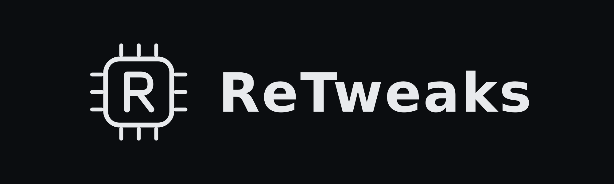

<p align="center">
  
</p>

<p align="center">
  <b>Free Windows PC diagnostics and optimization.</b><br>
  Real hardware readings, reversible tweaks, and honest results. No fake numbers.
</p>

<p align="center">
  <a href="https://github.com/w1zr/retweaks/releases/latest"><b>Download the latest release</b></a> ·
  <a href="https://w1zr.github.io/ReTweaks/"><b>Website</b></a> ·
  <a href="https://discord.gg/fS5NwW9TPF"><b>Discord</b></a>
</p>

---

## What it does

**Monitor**
- **Dashboard and Hardware:** CPU, GPU (exact model and real VRAM), motherboard and BIOS, RAM, drives and disk health, monitors, audio and network, plus live CPU and GPU load and clocks. Live temperatures (°C or °F) on the Dashboard and a Temperatures page.
- **Health Check:** one scan of startup apps, temp files, power plan, disk health, free space, pending restarts, Windows Update, Game Mode, refresh rate and RAM. Each check has a **Fix** button where RETWEAKS can help.
- **FPS test:** real average FPS, 1% lows and 0.1% lows measured with Intel PresentMon, with saved runs you can compare.
- **In-game FPS overlay:** live FPS, 1% low and frame time over games in borderless or windowed fullscreen. Nothing is injected into the game.
- **Display and drivers:** checks whether each monitor runs at its highest refresh rate, and shows your GPU driver version and age.

**Optimize**
- **Tweaks:** individual, explained tweaks, each with **Undo** and an "undo everything" option, plus a restore point.
- **Profiles, Game presets and Program rules:**
  - Game presets: Low, High, Ultra and Ultra Performance for Fortnite, Minecraft (Java and Bedrock), Apex Legends and Rocket League, or your own file. Backups are made first.
  - Program rules: per-program GPU choice and CPU priority.
  - Auto game mode and background calming.
- **Startup apps:** registry entries, Startup folders and scheduled tasks, which you can disable and re-enable at any time.
- **Network:** pick your own DNS, or go back to automatic; DNS speed test; ping test to 1.1.1.1.

- **Tuning library:** 117 more tweaks (including the Chris Titus Tech utility set), 12 quick presets (MAX FPS, Esports, Balanced, Streamer, Low-end, Laptop, Privacy, Clean & repair and more), Windows tweaks, and game profiles for 11 games.
- **Drivers:** finds the latest NVIDIA, AMD and Intel drivers and Windows Update driver updates, and downloads and installs them inside RETWEAKS. It asks first and checks the file's digital signature.

**Tools**
- **Storage and cleanup:** file explorer with drive usage, disk space analyzer, file search, and temp cleanup that always shows a preview first.
- **Daily Tools:** image to text (Windows OCR), image converter and resizer, images to PDF, text toolbox, file checksum and color picker. All local.
- **App Starter:** 100 curated apps for setting up a new PC, installed only when you choose.
- **PC Value Checker (beta), 3D PC Builder, Bottleneck tester and a render benchmark.**
- **Browser:** RETWEAKS's own browser on Microsoft's Edge engine (it runs as its own program, so it can't take RETWEAKS down), with tabs, private tabs, bookmarks as home-page shortcuts, history, downloads, zoom and your choice of search engine (Google, DuckDuckGo, Brave Search, Bing, Startpage or your own).
- **Fan control and RGB lighting:** fan speeds and temperature-based fan curves (Silent, Balanced, Performance, Full or your own), and fan + RAM lighting (Solid, Breathing, Color cycle, Rainbow, brightness, profiles). Fans go back to automatic if a temperature can't be read, at 85 °C, and when RETWEAKS closes.
- **Crosshair overlay:** 33 built-in crosshairs, an editor, share codes and a [community gallery](crosshairs/README.md). It sits on top of borderless/windowed games without touching the game; F9 shows or hides it. Follow each game's rules.
- **Audio mixer** (speakers, microphone and per-app volume), **auto clicker and Fun tools:** mouse polling rate test, clicks-per-second test and reaction time test.
- **AI assistant:** ask Google Gemini about your PC and RETWEAKS' tools through the built-in Gemini connection (your messages are sent to Google). It also helps with driver links, failed app installs and PC value estimates.
- **Snapshots and Logs:** sensor logging to CSV, and a log of every change RETWEAKS made.

**Everywhere:** search pages, settings and tweaks from the top bar (Ctrl+K); English, Español, Français, Deutsch and Português (Brasil) (machine translations, corrections welcome); a welcome tour on first start; optional automatic updates; tray icon with its own menu.

RETWEAKS never promises FPS gains. Use the FPS test to measure your own before and after.

## Bundled tools

Temperatures, fan control and RGB lighting use two open-source programs that come **built into RETWEAKS**, so
there's nothing extra to download or install:
[LibreHardwareMonitor](https://github.com/LibreHardwareMonitor/LibreHardwareMonitor) 0.9.6 (MPL-2.0) and
[OpenRGB](https://openrgb.org/) 1.1 (GPL-2.0), unmodified, in `ai/sensors` and `ai/openrgb` with their licenses.

CPU and motherboard temperatures, most fan control and usually RAM lighting also need the free
[PawnIO](https://github.com/namazso/PawnIO.Setup/releases) driver, because Windows only allows that hardware to be
read through a driver. It's a one-time install from PawnIO's official page; the Temperatures and Fan control pages
and Settings have a button that opens it. GPU and drive temperatures usually work without it.

## Install

1. Download `RETWEAKS.exe`, or `RETWEAKS.zip` if you prefer a zip, from the [latest release](https://github.com/w1zr/retweaks/releases/latest).
2. Run it. It asks for administrator rights, because many tweaks change system settings.
3. Updates install from inside the app. When a new version is out, a bar appears at the top of every page.

**Requirements:** Windows 10 or 11, 64-bit.

> RETWEAKS isn't code-signed, so Windows SmartScreen or your antivirus may show a warning. All the source code is here on GitHub. Always download from the official releases page.

## Build from source

```powershell
git clone https://github.com/w1zr/retweaks.git
cd retweaks
python -m pip install -r requirements.txt
python -m pytest tests     # run the tests
python retweaks.py         # run from source (Windows)
python build.py            # build dist\RETWEAKS.exe (Windows only; compiles the C# helpers in ai\ first)
```

Built with Python and Tkinter, plus small C# helpers (in `ai/`) for the AI and embedded web tabs. Every release is built on GitHub Actions on a Windows runner.

## License

RETWEAKS is licensed under the **GNU General Public License v3.0 only** (see [LICENSE](LICENSE)). Third-party components keep their own licenses; the WebView2 license and notice files are in `ai/`.

## Reporting a problem

Open an [issue](https://github.com/w1zr/retweaks/issues). In the app, **Settings → Report a problem** copies a hardware report (no personal info) for you to paste.
